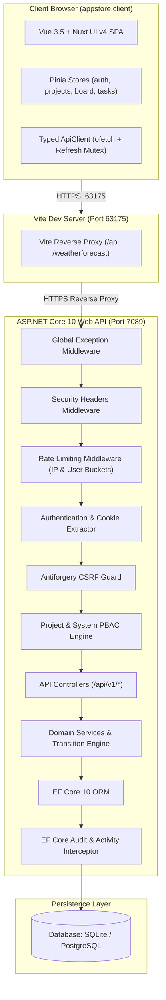
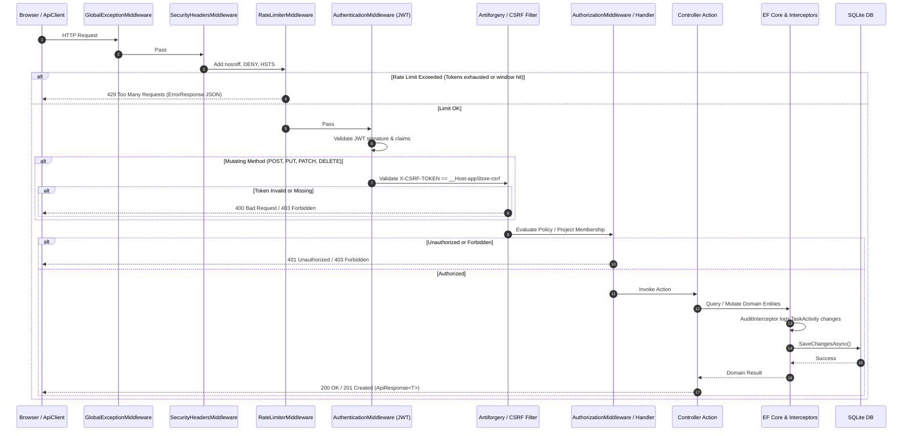
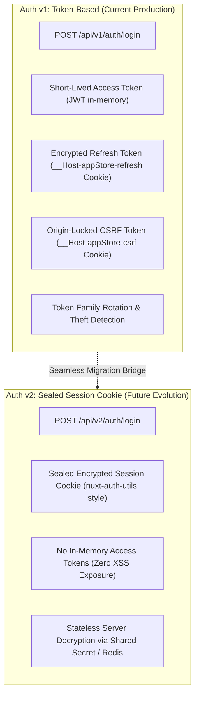
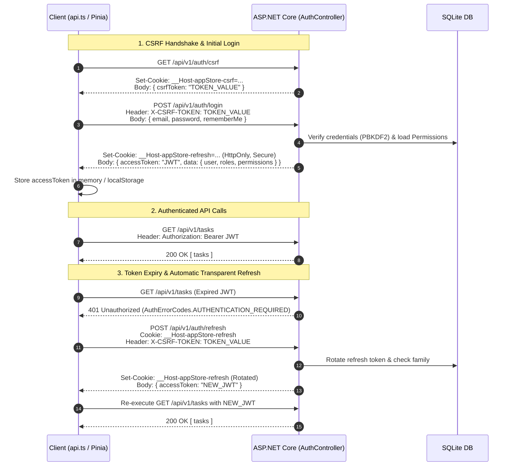
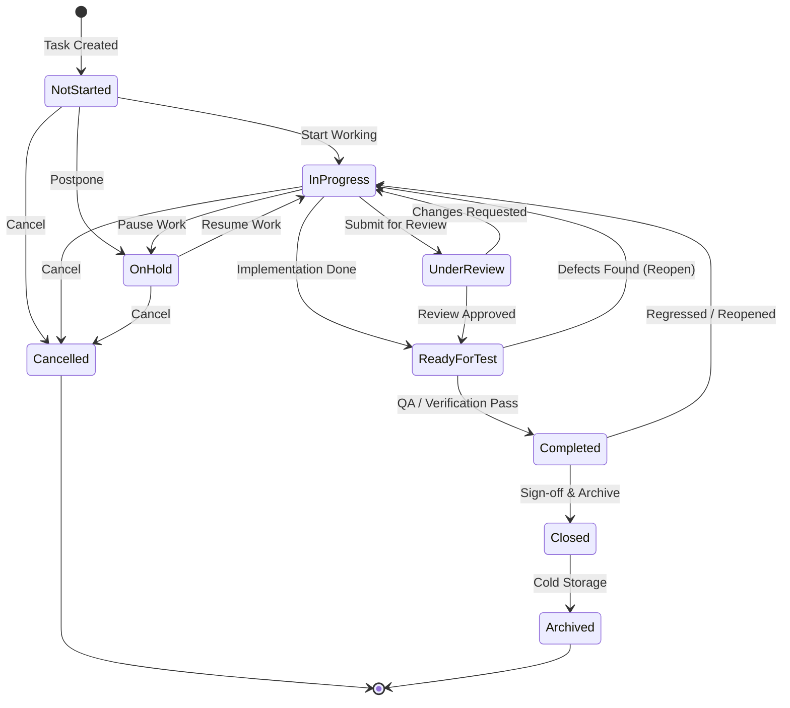
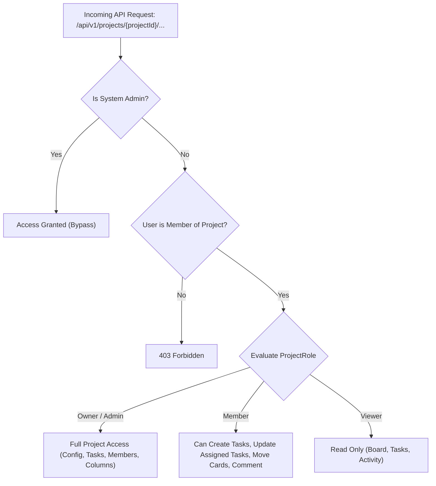
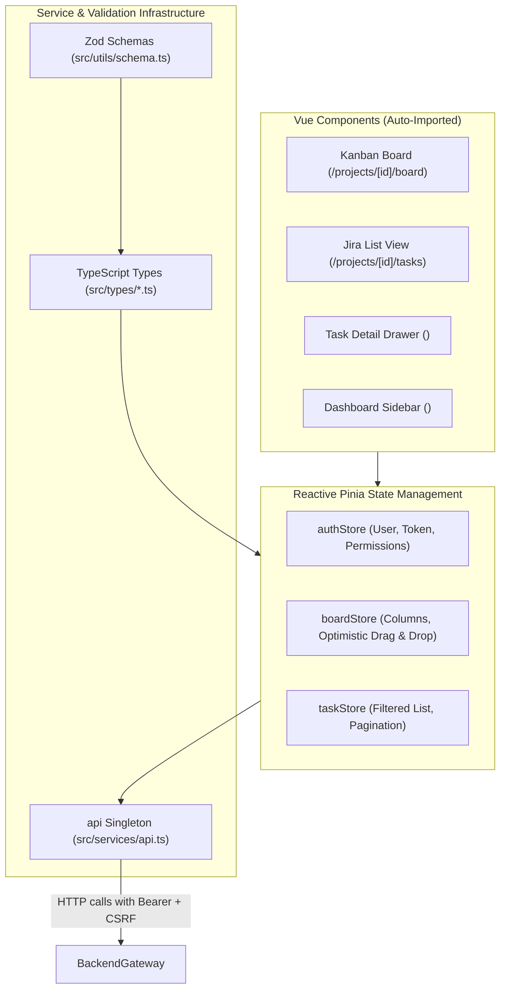

# AppStore: Enterprise Planner & Jira Hybrid Platform
## Master Architecture & Engineering Blueprint

> **Reference Documentation**: This document is the authoritative architectural specification, communication blueprint, domain model, security framework, and engineering reference for the `appStore` enterprise platform. All development, refactoring, and feature additions must adhere to the conventions and patterns documented herein.

---

## 1. System Overview & Technology Stack

The platform is an enterprise-grade Single Page Application (SPA) designed to combine the visual agility of **Microsoft Planner** (Kanban boards, bucket cards, checklists, assignees) with the workflow power and governance of **Jira** (formal state transition validation, project-scoped RBAC/PBAC, audit histories, subtask hierarchies, issue types).



### 1.1 Core Technologies

| Layer | Technology | Key Libraries / Modules |
| :--- | :--- | :--- |
| **Backend** | .NET 10.0 (C# 12/13) | `Microsoft.AspNetCore.OpenApi`, `Microsoft.AspNetCore.RateLimiting`, `Microsoft.AspNetCore.SpaProxy`, `Microsoft.EntityFrameworkCore.Sqlite`, `Swashbuckle.AspNetCore`, `System.IdentityModel.Tokens.Jwt` |
| **Frontend** | Vue 3.5 + TypeScript 6 | `@nuxt/ui` (v4), `@vueuse/core`, `@formkit/auto-animate`, `ofetch`, `pinia` (v4), `tailwindcss` (v4), `unplugin-vue-router`, `zod` |
| **Database** | SQLite / Postgres-ready | `appstore.db` (Code-first migrations via EF Core 10) |
| **Testing** | xUnit (.NET 10) | `appStore.Server.Tests` |

---

## 2. Repository Directory Structure

```text
c:/dev/appStore/
├── appStore.slnx                         # Visual Studio XML solution file
├── ARCHITECTURE.md                       # Master Architecture & Communication Blueprint
├── AGENTS.md                             # Agent guidelines (Vue prop shorthand, etc.)
│
├── appStore.Server/                      # ASP.NET Core 10 Web API project
│   ├── Program.cs                        # WebApplication bootstrapping & middleware pipeline
│   ├── appsettings.json                  # Logging and connection string configs
│   ├── appsettings.Development.json      # Dev logging overrides
│   ├── appstore.db                       # Local SQLite database file
│   ├── appStore.Server.csproj            # Project config, SpaProxy, and NuGet dependencies
│   ├── appStore.Server.http              # REST client test scratchpad
│   ├── Properties/
│   │   └── launchSettings.json           # Profiles for HTTP (:5044) & HTTPS (:7089)
│   ├── Authorization/                    # Permission-based access control engine
│   │   ├── AppPermissions.cs             # Constants & metadata for all system permissions
│   │   ├── AuthorizationClaimTypes.cs    # Custom claim type constants ("permission")
│   │   ├── PermissionAuthorizationHandler.cs # Evaluates permission claims
│   │   ├── PermissionPolicyProvider.cs   # Dynamic policy provider for "permission:*"
│   │   ├── PermissionRequirement.cs      # Auth requirement model for permissions
│   │   ├── RequirePermissionAttribute.cs # [RequirePermission("permission.name")]
│   │   ├── RequireSameUserOrPermissionAttribute.cs # User self-access OR manage permission
│   │   ├── SameUserOrPermissionAuthorizationHandler.cs
│   │   ├── SameUserOrPermissionRequirement.cs
│   │   └── ValidateAntiforgeryTokenAttribute.cs # Async filter for CSRF validation
│   ├── Configuration/                    # Strongly-typed option models
│   │   ├── CSRFTokenOptions.cs           # Cookie/Header names & security policies for CSRF
│   │   ├── JwtOptions.cs                 # Issuer, Audience, Secret, Lifetime
│   │   ├── RefreshTokenCookieOptions.cs  # Name, HttpOnly, SameSite, Secure policies
│   │   ├── RefreshTokenOptions.cs        # Lifetimes, Family Expiry, Sliding policies
│   │   └── SystemPasswordPolicyOptions.cs# Default password complexity settings
│   ├── Controllers/                      # REST API Controllers (Versioned /api/v1/*)
│   │   ├── AuthController.cs             # /api/v1/auth (csrf, login, signup, refresh, logout, me)
│   │   ├── TaskItemsController.cs        # /api/v1/tasks CRUD, status patch, and movement
│   │   ├── PriorityController.cs         # /api/v1/priorities CRUD
│   │   ├── RoleController.cs             # /api/v1/roles CRUD
│   │   ├── RolePermissionController.cs   # /api/v1/roles/{roleId}/permissions assignments
│   │   ├── UserController.cs             # /api/v1/users listing and self-lookup
│   │   ├── UserRoleController.cs         # /api/v1/users/{userId}/roles assignments
│   │   ├── WeatherForecastController.cs  # Sample /weatherforecast endpoint
│   │   └── Admin/
│   │       └── SecurityController.cs     # /api/v1/security/password-policy management
│   ├── Data/                             # Entity Framework Core context & configs
│   │   ├── DatabaseContext.cs            # DbSets & Fluent API model configuration
│   │   ├── Configurations/               # Entity type configurations (indexes, keys)
│   │   └── Migrations/                   # SQLite EF Core migration snapshots
│   ├── Dto/                              # Data Transfer Objects (Requests & Responses)
│   │   ├── Common/                       # Reusable envelopes: ApiResponse, PagedResponse, PaginationParams
│   │   ├── Permissions/                  # PermissionDto, Create/Update DTOs
│   │   ├── Priorities/                   # PriorityDto, Create/Update DTOs
│   │   ├── Roles/                        # RoleDto, UserRoleDto, RolePermissionDto
│   │   ├── Security/                     # PasswordPolicyDto, UpdatePasswordPolicyDto
│   │   ├── Tasks/                        # TaskDto, TasksListDto, Create/Update/Patch DTOs
│   │   └── Users/                        # UserDto, CreateUserDto, UserLoginDto
│   ├── Errors/                           # Standardized error handling subsystem
│   │   ├── AppException.cs               # Domain exceptions (NotFound, Conflict, etc.)
│   │   ├── AuthErrorCodes.cs             # Auth-specific error codes
│   │   ├── ErrorCodes.cs                 # Global error code constants
│   │   ├── ErrorHandlingExtensions.cs    # app.UseGlobalExceptionHandling()
│   │   ├── ErrorResponse.cs              # Standard JSON error payload schema
│   │   └── GlobalExceptionMiddleware.cs  # Catches all exceptions -> ErrorResponse JSON
│   ├── Extensions/                       # Service registration & initialization extensions
│   │   ├── ApiBehaviourExtensions.cs     # Model validation formatting & Antiforgery setup
│   │   ├── AuthenticationExtensions.cs   # AddJwtAuthentication with custom 401/403 handlers
│   │   ├── AuthorizationExtensions.cs    # Registers custom handlers & policy providers
│   │   ├── DataBaseExtensions.cs         # SQLite configuration, Migration, and Seeding
│   │   ├── JwtConfigurationExtensions.cs # Reads JWT env/user secrets
│   │   ├── RateLimiterExtensions.cs      # Native .NET 10 rate limiting policies
│   │   ├── RefreshTokenConfigurationExtensions.cs
│   │   ├── SecurityHeadersExtensions.cs  # HSTS, CSP, nosniff, framing protection
│   │   └── ServiceExtensions.cs          # Scoped/Singleton DI registrations
│   ├── Models/                           # EF Core entity models
│   │   ├── PasswordPolicy.cs
│   │   ├── Permission.cs
│   │   ├── Priority.cs
│   │   ├── Project.cs                    # Project with Owner, Members, Columns, and Tasks
│   │   ├── ProjectMember.cs              # Project membership & ProjectRole
│   │   ├── RefreshToken.cs
│   │   ├── Role.cs
│   │   ├── RolePermission.cs
│   │   ├── Status.cs                     # Enum: Task workflow statuses
│   │   ├── TaskItem.cs                   # Task item with Key, Status, Priority, Project
│   │   ├── User.cs
│   │   └── UserRole.cs
│   ├── Services/                         # Domain service implementations
│   │   ├── AuthenticationService.cs      # Login, refresh, family rotation, logout
│   │   ├── JwtTokenService.cs            # Access token creation with claims
│   │   ├── PasswordHasher.cs             # PBKDF2 with SHA-256 salt & hashing
│   │   ├── PasswordPolicyService.cs      # Password policy validation & storage
│   │   ├── RefreshTokenCookieService.cs  # Reads/writes __Host-appStore-refresh cookie
│   │   ├── RefreshTokenService.cs        # Crypto RNG generation & SHA-256 token hashing
│   │   ├── UserAuthorizationService.cs   # Gathers roles & permissions snapshot
│   │   ├── UserService.cs                # User creation & lookup
│   │   ├── Interfaces/                   # Service abstractions
│   │   └── Security/                     # Password policy rules and regex validators
│   └── Utils/
│       └── GeneralUtilities.cs
│
├── appstore.client/                      # Vue 3 SPA frontend
│   ├── package.json                      # Dependencies & scripts
│   ├── vite.config.ts                    # Vite config, dev certs, Nuxt UI plugin, proxy
│   ├── appstore.client.esproj            # Visual Studio JavaScript project file
│   ├── index.html                        # SPA HTML root entry point
│   ├── src/
│   │   ├── main.ts                       # App bootstrap (Vue, Pinia, Nuxt UI, Router)
│   │   ├── App.vue                       # Root component wrapping <UApp> & <RouterView />
│   │   ├── assets/
│   │   │   └── main.css                  # Tailwind v4, Nuxt UI CSS & theme variables
│   │   ├── components/                   # Auto-imported Vue components
│   │   │   ├── dashboard/                # Sidebar, header, widgets, calendar
│   │   │   └── ui/                       # Reusable UI controls
│   │   ├── layouts/                      # Layout wrappers (dashboard.vue, auth.vue)
│   │   ├── pages/                        # File-based routed views
│   │   │   ├── index.vue                 # Home dashboard view
│   │   │   ├── auth/                     # login.vue, signup.vue, forgotPassword.vue
│   │   │   ├── tasks/                    # index.vue, [id].vue
│   │   │   └── team.vue                  # Team directory view
│   │   ├── router/
│   │   │   └── index.ts                  # Vue router configured with auto-routes
│   │   ├── services/
│   │   │   ├── api.ts                    # ofetch wrapper with interceptors & auto-refresh
│   │   │   └── index.ts                  # Barrel export
│   │   ├── stores/                       # Pinia state stores
│   │   │   ├── authStore.ts              # Authentication state, login, logout
│   │   │   └── weatherStore.ts           # Weather forecast demo store
│   │   ├── types/                        # Inferred TypeScript type definitions
│   │   │   ├── endpoints.ts              # Strongly-typed API routes & payload mapping
│   │   │   ├── tasks.ts                  # Task models & DTOs
│   │   │   └── index.ts                  # Barrel export
│   │   └── utils/
│   │       └── schema.ts                 # Zod runtime schemas (Single Source of Truth)
│
└── appStore.Server.Tests/                # Automated tests
    ├── UnitTest1.cs                      # PasswordHasher unit tests
    └── appStore.Server.Tests.csproj
```

---

## 3. Security, Gateway & Request Lifecycle Pipeline

Every HTTP request entering the backend traverses a strictly ordered defense-in-depth pipeline:



### 3.1 Multi-Tiered Rate Limiting (.NET 10 Native)

Rate limiting is partitioned dynamically to protect resources while preventing cross-user starvation:

1. **`auth-policy` (`POST /api/v1/auth/login`, `POST /api/v1/auth/signup`)**:
   - Algorithm: Fixed Window (10 requests per 1 minute window).
   - Partition Key: Client IP (`Connection.RemoteIpAddress`).
   - Queue: 0. Rejects immediately on threshold breach to prevent brute-force attacks.
2. **`api-policy` (Standard API queries)**:
   - Algorithm: Sliding Window (120 requests per 1 minute window, 4 segments).
   - Partition Key: Authenticated `UserId` (falls back to client IP for anonymous requests).
   - Queue: 2. Smooths minor traffic bursts.
3. **`mutation-policy` (State-modifying operations: task creation, moves, status transitions)**:
   - Algorithm: Token Bucket (40 token capacity, 10 tokens replenished every 15 seconds).
   - Partition Key: `UserId` or client IP. Prevents automated spam and bulk updates.

When rejected, the `OnRejected` callback intercepts the context and returns:

```json
{
  "status": 429,
  "code": "RATE_LIMIT_EXCEEDED",
  "message": "Too many requests. Please slow down and try again later.",
  "traceId": "0HN123456789:00000001",
  "details": {
    "retryAfterSeconds": 45
  }
}
```

### 3.2 Security Headers Matrix

Injected into every response via `SecurityHeadersExtensions`:

| Header | Value | Rationale |
| :--- | :--- | :--- |
| `X-Content-Type-Options` | `nosniff` | Prevents browser MIME-type sniffing vulnerabilities. |
| `X-Frame-Options` | `DENY` | Prohibits embedding inside `<iframe>` tags (clickjacking prevention). |
| `Referrer-Policy` | `strict-origin-when-cross-origin` | Protects privacy by omitting URL paths on cross-origin requests. |
| `X-Permitted-Cross-Domain-Policies` | `none` | Blocks Flash/PDF cross-domain policy access. |
| `Permissions-Policy` | `camera=(), microphone=(), geolocation=()` | Disables unused browser hardware capabilities. |
| `Strict-Transport-Security` | `max-age=31536000; includeSubDomains` | Enforces HTTPS strictly for 1 full year (active on HTTPS requests). |

---

## 4. Dual Authentication Strategy: v1 (Token) vs v2 (Session)

To support both stateless client architectures and server-side rendered or sealed cookie session architectures, the system defines two evolutionary paths:



### 4.1 Auth v1: Current Token + Cookie Flow



### 4.2 Refresh Token Rotation & Family Tracking
- Every refresh token is tagged with a `TokenFamilyId`.
- When `/api/v1/auth/refresh` is executed, the presented token is revoked, and a successor token is minted in the same family.
- If a revoked token is ever presented again (replay attack/theft), the server revokes the **entire family**, instantly terminating all compromised sessions.

### 4.3 Auth v2: Future Sealed Cookie Architecture (`nuxt-auth-utils` Style)
In version 2 (`/api/v2/auth/*`):
- Eliminates JWT access tokens from browser memory entirely.
- The server emits an AES-256 encrypted, sealed session cookie containing user identity and session ID.
- The frontend makes all API requests with standard credentials (`credentials: "include"`).
- Server decrypts and verifies the session seal per request, offering zero token surface area for XSS exfiltration.

---

## 5. Planner + Jira Hybrid Domain Model

The entity structure unites visual Kanban columns (Planner) with structured task keys, subtasks, assignments, and audit logging (Jira):

```mermaid
erDiagram
    Project ||--o{ ProjectMember : has
    Project ||--o{ BoardColumn : defines
    Project ||--o{ TaskItem : contains
    User ||--o{ ProjectMember : participates
    User ||--o{ TaskItem : reports
    User ||--o{ TaskItem : assigned_to
    User ||--o{ RefreshToken : owns
    User ||--o{ UserRole : has
    Role ||--o{ UserRole : assigned_to
    Role ||--o{ RolePermission : has
    Permission ||--o{ RolePermission : granted_to
    TaskItem ||--o{ TaskItem : subtasks
    TaskItem ||--o{ TaskChecklist : contains
    TaskItem ||--o{ TaskComment : receives
    TaskItem ||--o{ TaskActivity : tracks
    TaskItem }|--|| Priority : categorizes
    BoardColumn ||--o{ TaskItem : positions

    Project {
        Guid Id PK
        string Name
        string Key UK "e.g. CORE, OPS"
        string Description
        string Icon
        Guid OwnerId FK
        DateTime CreatedAt
        DateTime UpdatedAt
    }

    ProjectMember {
        Guid ProjectId FK
        Guid UserId FK
        int Role "Enum: Owner, Admin, Member, Viewer"
        DateTime JoinedAt
    }

    BoardColumn {
        Guid Id PK
        Guid ProjectId FK
        string Name "e.g. Backlog, In Progress, Review, Done"
        int OrderIndex
        int StatusMapping "Mapped to Status Enum"
        int WIPLimit "Work In Progress limit (0 = none)"
        DateTime CreatedAt
    }

    TaskItem {
        Guid Id PK
        string TaskKey UK "e.g. CORE-104"
        string Name
        string Description
        Guid ProjectId FK
        Guid? ColumnId FK
        int OrderIndex
        int PriorityId FK
        int Status "Enum: NotStarted -> Completed"
        int IssueType "Enum: Task, Bug, Story, Epic"
        Guid? AssigneeId FK
        Guid ReporterId FK
        Guid? ParentTaskId FK
        DateTime? DueDate
        int? EstimatedMinutes
        bool IsCompleted
        DateTime CreatedAt
        DateTime UpdatedAt
        DateTime? CompletedAt
    }

    TaskChecklist {
        Guid Id PK
        Guid TaskId FK
        string Title
        bool IsCompleted
        int OrderIndex
    }

    TaskComment {
        Guid Id PK
        Guid TaskId FK
        Guid AuthorId FK
        string Content
        DateTime CreatedAt
        DateTime UpdatedAt
    }

    TaskActivity {
        Guid Id PK
        Guid TaskId FK
        Guid ActorId FK
        string ActionType "StatusChanged, Assigned, Moved, Commented"
        string OldValue
        string NewValue
        DateTime CreatedAt
    }

    Priority {
        int Id PK
        string Name UK "Low, Medium, High, Emergency"
    }

    User {
        Guid Id PK
        string Name
        string Email UK
        string PasswordHash
        string PhoneNumber
        bool IsEmailVerified
        bool IsUserActive
        string ProfilePictureUrl
        DateTime CreatedAt
        DateTime UpdatedAt
        DateTime LastLoginAt
    }
```

---

## 6. Task Workflow Finite-State Machine (FSM)

To prevent invalid lifecycle leaps (e.g. jumping straight from `NotStarted` to `Closed` without validation), task status updates validate against an explicit transition matrix:



### 6.1 Transition Guard Table

| From Status | Allowed Target Statuses | Validation Requirements |
| :--- | :--- | :--- |
| `NotStarted` | `InProgress`, `OnHold`, `Cancelled` | Requires `task.update` or Project `Member`+ |
| `InProgress` | `UnderReview`, `ReadyForTest`, `OnHold`, `Cancelled` | Requires task to be assigned (`AssigneeId != null`) |
| `UnderReview`| `InProgress` (rejected), `ReadyForTest` (approved) | Reviewer cannot be the assignee |
| `ReadyForTest`| `Completed` (verified), `InProgress` (failed QA) | Must pass all checklist items |
| `Completed` | `Closed`, `InProgress` (reopened) | Assignee or Project Admin only |
| `OnHold` | `InProgress`, `Cancelled` | Project `Member`+ |
| `Closed` | `Archived` | Project `Admin` or `Owner` only |

---

## 7. Project-Scoped PBAC Authorization Subsystem

Authorization operates on two complementary tiers:
1. **System Roles & Permissions (Global)**: High-level administration (`users.manage`, `roles.manage`, `security.manage`).
2. **Project Roles (Resource-Scoped)**: Scoped to the active project:



---

## 8. Standardized API Catalog (`/api/v1/*`)

All API responses conform to unified envelope models:
- **Single Item Envelope**: `ApiResponse<T>` (`message`, `data`).
- **Paginated Collection Envelope**: `PagedResponse<T>` (`items`, `totalCount`, `pageNumber`, `pageSize`, `totalPages`, `hasPreviousPage`, `hasNextPage`).
- **Error Envelope**: `ErrorResponse` (`status`, `code`, `message`, `traceId`, `details`).

### 8.1 API Endpoint Matrix

| Module | Route | Method | Rate Limit | CSRF | Permission / Role | Request Body | Response |
| :--- | :--- | :--- | :--- | :--- | :--- | :--- | :--- |
| **Auth** | `/api/v1/auth/csrf` | `GET` | Open | No | Public | _None_ | `{ csrfToken }` |
| **Auth** | `/api/v1/auth/signup` | `POST` | `auth-policy` | Yes | Public | `CreateUserDto` | `201 Created` (`ApiResponse<UserDto>`) |
| **Auth** | `/api/v1/auth/login` | `POST` | `auth-policy` | Yes | Public | `UserLoginDto` | `200 OK` (`LoginResult`) + Cookie |
| **Auth** | `/api/v1/auth/refresh` | `POST` | `auth-policy` | Yes | Public | _None_ | `200 OK` (`{ accessToken }`) + Rotated Cookie |
| **Auth** | `/api/v1/auth/logout` | `POST` | `api-policy` | Yes | Public | _None_ | `204 NoContent` + Clears Cookie |
| **Auth** | `/api/v1/auth/me` | `GET` | `api-policy` | No | Authorized | _None_ | `ApiResponse<UserDto>` |
| **Tasks** | `/api/v1/tasks` | `GET` | `api-policy` | No | `tasks.read` | `PaginationParams` | `PagedResponse<TasksListDto>` |
| **Tasks** | `/api/v1/tasks/{id}` | `GET` | `api-policy` | No | `tasks.read` | _None_ | `ApiResponse<TaskDto>` |
| **Tasks** | `/api/v1/tasks` | `POST` | `mutation-policy`| Yes | `task.create` | `CreateTaskDto` | `201 Created` (`ApiResponse<TaskDto>`) |
| **Tasks** | `/api/v1/tasks/{id}` | `PUT` | `mutation-policy`| Yes | `task.update` | `UpdateTaskDto` | `204 NoContent` |
| **Tasks** | `/api/v1/tasks/{id}` | `PATCH`| `mutation-policy`| Yes | `task.update` | `PatchTaskDto` | `ApiResponse<TaskDto>` |
| **Tasks** | `/api/v1/tasks/{id}` | `DELETE`| `mutation-policy`| Yes | `task.delete` | _None_ | `204 NoContent` |
| **Tasks** | `/api/v1/tasks/{id}/move` | `POST` | `mutation-policy`| Yes | `task.update` | `MoveTaskDto` | `ApiResponse<TaskDto>` |
| **Tasks** | `/api/v1/tasks/{id}/status`| `PATCH`| `mutation-policy`| Yes | `task.update` | `StatusTransitionDto`| `ApiResponse<TaskDto>` |
| **Priorities** | `/api/v1/priorities` | `GET` | `api-policy` | No | Public | _None_ | `ApiResponse<PriorityDto[]>` |
| **Priorities** | `/api/v1/priorities` | `POST` | `mutation-policy`| Yes | Admin | `CreatePriorityDto` | `201 Created` |
| **Roles** | `/api/v1/roles` | `GET` | `api-policy` | No | Public | _None_ | `ApiResponse<RoleDto[]>` |
| **Roles** | `/api/v1/roles` | `POST` | `mutation-policy`| Yes | `roles.manage` | `CreateRoleDto` | `201 Created` |
| **Users** | `/api/v1/users` | `GET` | `api-policy` | No | `users.manage` | `PaginationParams` | `PagedResponse<UserDto>` |
| **Users** | `/api/v1/users/{id}`| `GET` | `api-policy` | No | SameUser / Admin| _None_ | `ApiResponse<UserDto>` |
| **Security** | `/api/v1/security/password-policy` | `GET` | `api-policy` | No | Public | _None_ | `ApiResponse<PasswordPolicyDto>` |
| **Security** | `/api/v1/security/password-policy` | `PUT` | `mutation-policy`| Yes | `security.manage`| `UpdatePasswordPolicyDto`| `ApiResponse<PasswordPolicyDto>` |

---

## 9. Frontend Architecture & Client Services



### 9.1 Schema-First Typing Workflow
1. Runtime validation schemas are authored in [`src/utils/schema.ts`](file:///c:/dev/appStore/appstore.client/src/utils/schema.ts) using Zod.
2. Domain types are strictly derived via `z.infer<typeof ...>` in `src/types/`.
3. Auto-imports ensure components and forms consume schemas and stores directly without manual import declarations.
4. Same-Name Prop Shorthand (Vue 3.4+) is enforced across all templates (e.g. `<DashboardTasksPreview :tasks />`, `<DashboardProjects :projects />`).

---

## 10. Developer Operations & Execution Guide

### 10.1 Running the Environment

- **Full Application via Visual Studio**:
  Launch `appStore.Server` using the HTTPS profile (`https://localhost:7089`). The `Microsoft.AspNetCore.SpaProxy` automatically launches the Vite dev server at `https://localhost:63175`.
- **Manual CLI Launch**:
  ```powershell
  # Terminal 1: Backend
  cd appStore.Server
  dotnet run --launch-profile https

  # Terminal 2: Frontend
  cd appstore.client
  pnpm run dev
  ```

### 10.2 Migrations & Seed Management
```powershell
# Add EF Core migration
dotnet ef migrations add <MigrationName> --project appStore.Server --startup-project appStore.Server

# Update database manually
dotnet ef database update --project appStore.Server --startup-project appStore.Server
```

---
